# Warden and broker: a Quint model of approval and mint

A design-level Choreo model of how yard turns an agent's request for cloud
access into short-lived, scoped credentials: the warden drafts a card, the
user approves it on the tailnet page (with a passkey for escalations), the
yard-ctl STS signs a JWT, the broker exchanges it with the cloud STS, and the
broker serves the result on the metadata endpoints the sandbox's SDK polls.

The design is `research/agent-platform/WARDEN.md` (v2 with the user's
decisions of 2026-10-06, and the twelve decisions of 2026-10-07 that came out
of this model), `IDENTITY.md`, `CONTROL-PLANE.md`, `HARNESS.md`,
`TRAINING-DATA.md`, and the SR0 credential epoch (yard branch `sr0`,
`internal/lifecycle` and `internal/issuer`). The modelling rules are
casselc/observability otel-chdb/model/TEMPLATE.md: every cross-boundary call
has a lost request, a late effect, a lost answer (applied, and the caller
hears nothing or an error) and duplicate delivery; the caller's rule is a
constant; each unsafe rule is a named mutant beside the design; and
durations are modelled where time matters.

**Results in one line.** The design with the decisions of 2026-10-07 keeps
all fifteen properties over 20,000 random traces of 80 steps (seed
`0x5eed`), every witness is reached, and every mutant breaks the property it
is named for. The first version of this model found WARDEN.md's text of
2026-10-06 unsafe in two places (credentials outliving the approved TTL by up
to 15 minutes; "Revoke active sessions" missing a mint already in flight) and
contradictory in a third (the session-template button). Those texts are now
mutants (`asWrittenEnd`, `asWrittenRevoke`, `sessionTemplateButton`), and
WARDEN.md carries the fixes ("Decisions 2026-10-07 (from the Quint model)").

## Files

| File | What it is |
|---|---|
| `wardenLogic.qnt` | The pure logic: types, the design's numbers, the `Rules` record (one field per caller rule), and the guards and updates (`refusal`, `newGrant`, `mintable`, `jwtExp`, `renderForMint`, `denyCutoff`, `mint`, `usable`, `mayDrop`). No state. |
| `warden.qnt` | The Choreo wrapper: messages, one local-state record for every role, the listen/act pairs per party (`main_listener` reads like the protocol), time (`tick`), loss (`loseMessage`), the ghost record, invariants and witnesses. Parametric in `const RULES`. |
| `wardenRuns.qnt` | Scripted runs, parametric in the rules: the design's paths and, per mutant and finding, the shortest schedule we know (`*BreaksTest`) and the same schedule on the design (`*DesignTest`). |
| `wardenTest.qnt` | The instances: `designAws`, `designAzure`, nineteen mutants (three of them WARDEN.md's text before 2026-10-07), and a `runs<Name>` module per instance for the scripted runs. |
| `run.sh` | Runs everything and prints the table; exits non-zero if any row is not as expected. |
| `results.txt` | The table from the last run (below). |
| `choreo.qnt`, `spells/basicSpells.qnt` | The Choreo framework and Quint's basic spells, copied unchanged from the quint-llm-kit examples (Informal Systems). |

Commands (quint 0.32.0, `quint typecheck`, `quint run` and `quint test` only):

```sh
quint typecheck spec/warden/wardenTest.qnt
OUT=spec/warden/results.txt spec/warden/run.sh      # SAMPLES=20000 MSAMPLES=5000 STEPS=80 SEED=0x5eed
# one row by hand:
quint run spec/warden/wardenTest.qnt --main designAws --invariant safety --max-samples 20000 --max-steps 80 --seed 0x5eed
quint run spec/warden/wardenTest.qnt --main blindRetry --invariant atMostOneMintPerSlot --max-samples 5000 --max-steps 80 --seed 0x5eed
quint test spec/warden/wardenTest.qnt --main runsBlindRetry --match '^blindRetryBreaksTest$' --max-samples 1
```

## Parties and assumptions

| Party | Choreo process | Trusted? | What it holds and does |
|---|---|---|---|
| Sandbox / agent | `sbxA`, `sbxB` | **No** | Asks for anything (any template, region, TTL, the deny-listed `admin`), re-asks with other parameters, withdraws. Its SDK polls 169.254.170.2 / 169.254.169.254 all the time, naming any sandbox it likes in the request. It cannot reach the approval page or yard-ctl except through the broker. |
| Broker | `broker` | Yes | One per node. Identifies the caller by its tap (epair + mac_ipacl), never by what the request says. Asks yard-ctl for a JWT, calls AssumeRoleWithWebIdentity itself (decision 8), holds the result, serves it (AWS: the credentials; Azure: a surrogate token, the real one swapped in transit), writes the `warden.mint` row. Tracks the newest credential epoch per sandbox and refuses stale ones (SR0); acknowledges each epoch notice; after a crash (start or reconnect) pulls the epochs and exchanges, holds and serves nothing until the answer to its latest pull. Drops its cache on a home-IP change. Volatile state; may crash once. |
| yard-ctl | `ctl` | Yes | The warden module and the yard-ctl STS in one process (WARDEN §1: "a module inside yard-ctl"), so the warden-to-STS call is local. Intake, drafting, the mechanical checks, cards, single-use passkey challenges, decisions, grants, JWT signing (one per grant, 10-min slot and home-IP generation, at most 3 per grant), revoke on abort, withdraw and supersede, the session's phase and credential epoch (the epoch moves at suspend; a resume completes only on the broker's acknowledgement), the CloudTrail reconciler and the orphan revoke. Durable (SQLite). |
| User | `user` | Yes | The tailnet approval page (ntfy only links to it). Approve at the card's TTL or shorter (the approval binds the re-hashed card), deny, ask for a passkey challenge over the final hash, abort. The session-template button exists only in its mutant. Decides each card once. |
| Cloud STS | `cloud` | Yes | `AssumeRoleWithWebIdentity` with the session policy (or Entra's token exchange). Mints while the JWT is unexpired, refuses an expired one; answers with credentials, with an error after minting, or not at all. Applies the `aws:TokenIssueTime` deny. |

**Network.** Choreo's per-recipient message sets: a message stays until
`loseMessage` removes it, so any message may be delayed arbitrarily,
reordered, met again by its handler (duplicate delivery), or lost. Handlers
that must be idempotent are written so (intake and JWT requests are marked
handled; decisions are deliberately *not*, so a duplicate approval meets the
warden again). Metadata polls are never lost (the SDK repeats them).

**Time.** One tick is 5 minutes, at most 14 ticks.

| Duration | Model | Source |
|---|---|---|
| JWT lifetime | 1 tick | IDENTITY.md "at most 5 minutes"; the signer forces `exp − iat ≤ 5 min` (CONTROL-PLANE §3) |
| AWS session | 3 ticks | WARDEN §2.2 "sessions are always 900 s"; also AWS's minimum `DurationSeconds`, so it cannot be shortened to fit the TTL |
| Re-mint period (renewal slot) | 2 ticks | WARDEN §4 step 8 "re-mints every 10 min while the grant is live" |
| Card expiry | 3 ticks | WARDEN §5 "unanswered requests expire after 15 min" |
| Passkey freshness | 1 tick | decision 4 (2026-10-07): 5 min, judged when the decision reaches the warden |
| CloudTrail delivery | 3 ticks | **assumed** 15 min (accepted 2026-10-07), **to measure on the sandbox account**; the reconciler's settle bound |
| Mints per grant | at most 3 | **assumed** (accepted 2026-10-07): two renewal slots and one IP change; decision 7 |
| Task TTL | 4 or 6 ticks from the approval, class maximum 6 | scaled down from hours, so renewals and the end both fit in a run; decision 11 |

**Abstractions.**
- The card's content `{sbx, req, ver, pol, region, ttl}` stands for
  everything the approval binds: `pol` for the policy bytes (inline policy,
  PolicyArns, tags), `region` for scope (account and region), `sbx` for the
  principal (RoleSessionName, `yard-sandbox` tag, JWT `sub`), `ttl` for the
  TTL, `ver` for the request version. The hash is injective. The card shows
  the requested TTL; the approval binds the card re-hashed with the approved
  TTL (decision 5), and that hash travels as the `yard-apv`/`yard-psha`
  session tags (`Cred.h`).
- `iam` (iam-lite, decision 4) is the elevated class that needs a passkey
  (decision 7); an escalation delta is the same case. `admin` stands for
  anything the static checks block.
- Drafting is not modelled separately: the local Qwen only fills a template,
  and the untrusted agent's own choice of intent already ranges over every
  template and parameter, so an injected drafter adds no behaviour. What
  matters, and what is modelled, is that a draft is never an approval
  (mutant `draftApproves`).
- Renewal: a grant has slots of 10 minutes from its start; yard-ctl signs at
  most one JWT per (grant, slot, home-IP generation), a create-only row, and
  at most 3 per grant (decision 7). The home IP changes once at most.
- SR0: each sandbox has a session phase (active, suspended, resuming) and a
  credential epoch in yard-ctl; a suspend moves the epoch (at most one per
  sandbox). The STS signs the current epoch. A resume sends the broker the
  new epoch and completes only on its acknowledgement; the broker also
  learns epochs from newer JWTs and from its pull after a restart.
- CloudTrail is a ghost log the cloud appends at each mint and yard-ctl may
  read once it is CT_LAG old.
- AWS and Azure share the mint abstraction (a token with an expiry); they
  differ only in what the broker hands the VM.

## Ambiguity register

Done / not done / unknown per call, as in casselc/observability AMBIGUITY.md.
"Dn" is the decision of 2026-10-07 that settles the rule.

| Call | Done / not done / unknown | Settle bound | Resolving observation | Caller rule | Quint actions | Mutant |
|---|---|---|---|---|---|---|
| Agent request `POST /warden/requests` (sandbox → broker → yard-ctl) | done: a card shown, or blocked by the checks; unknown: no answer | none needed | the card on the page (the agent re-asks) | idempotent retry: the same (tap, req, intent) is one card (`handled`); a changed intent is a new version and supersedes a pending one | `sbx_request`, `act_intake`, `loseMessage`, re-delivery | `editInPlace` |
| Withdraw (sandbox → yard-ctl) | done: the card is withdrawn and the task's grant revoked (D10); unknown: no answer | none | the card's status | idempotent retry | `sbx_withdraw`, `act_withdraw` | `supersedeKeepsGrant` |
| Card to the page and ntfy (yard-ctl → user) | done: shown; unknown: lost or late | card expiry, 15 min | the page lists the card and its expiry | wait: an unanswered card expires | `act_intake` (CardMsg), `loseMessage` | – |
| Passkey challenge (user ↔ yard-ctl) | done: a challenge over the final hash; unknown: lost | the freshness window, 5 min (D4) | – | fence: the warden checks the assertion is over a challenge it issued, unused (single-use), over the decision's final hash (with any shortened TTL), and at most 5 min old **when the decision arrives** | `act_ask_challenge`, `act_challenge`, `act_decide` | `passkeyNotBound`, `passkeyNotFresh` |
| Decision (user → yard-ctl) | done: the card shows approved or denied; not done: refused (status, hash, expired, TTL, passkey); unknown: lost, late, duplicated | card expiry, dated at the warden's arrival (D9) | the card's status on the page | fence (expiry at arrival; final-hash match, D5) and idempotent retry (keyed by the hash; a duplicate of an approved card changes nothing); an accepted approval revokes the task's older grant (D10) | `act_decide`, `act_decision`, `loseMessage`, re-delivery | `approvalNotHashBound`, `expiryAtClick`, `replayExtends`, `supersedeKeepsGrant`; `draftApproves` (no decision at all) |
| JWT request (broker → yard-ctl STS) | done: a JWT; not done: no mintable grant (no answer in the model; the next poll asks again); unknown: the JWT signed and its answer lost | the JWT's `exp`, clamped to grant end − 15 min (D1) | none needed: the key is spent | idempotent: one JWT per (grant, slot, IP generation), create-only, at most 3 per grant (D7); a lost answer costs that slot; the JWT carries the session's credential epoch | `act_fetch`, `act_jwt`, `loseMessage` | `expiryAtRequest` (exp not clamped to the grant) |
| `AssumeRoleWithWebIdentity` (broker → cloud STS) | done: credentials; not done: `ExpiredToken` for that copy; **unknown:** no answer, an error after the mint, a timeout | the JWT's `exp` (AWS refuses an expired JWT): the fence on a late copy | for safety none (the secret exists only in the answer, so an orphan is usable by nobody); for the audit the CloudTrail reconciler (row below) | fence + never re-send a JWT, SDK retries off (D6); drop the attempt once settled, adopt a late answer (unless its epoch or IP generation is stale), mint again in the next slot; a JWT of a stale epoch is refused before sending | `act_exchange`, `act_assume` (Creds / MintErr / MintRejected), `loseMessage`, `act_timeout`, `act_err`, `act_creds`, `act_crash` | `blindRetry`, `waitForAnswer`, `staleEpochAccepted` |
| `warden.mint` row (broker → yard-ctl) | done: recorded; unknown: lost | – | the reconciler (next row) | none: a lost row is found as an orphan | `act_creds` (MintAudit), `act_mint_audit` | – |
| CloudTrail reconciler (yard-ctl reads CloudTrail) | an observation; an event may lag | CloudTrail delivery, assumed 15 min (to measure) | AssumeRoleWithWebIdentity events by `yard-apv`, `yard-psha`, `yard-mint`, RoleSessionName, against `warden.mint` rows | wait until the event is CT_LAG old, then record it as an orphan and revoke it (D12, D15) | `listen_reconcile`, `act_reconcile` | `noReconciler` |
| Orphan revoke (yard-ctl → IAM, a deny on the mint's `yard-mint` tag) | done: OrphanDenyOk; unknown: lost | IAM propagation (not modelled) | read the policy back (OrphanDenyOk) | idempotent retry until confirmed (D15) | `act_reconcile`, `act_resend_orphan_deny`, `act_orphan_deny`, `act_orphan_ok` | `orphanOnlyRecorded` |
| Epoch notice on resume (yard-ctl → broker, SR0) | done: the broker's acknowledgement for the current epoch; unknown: notice or acknowledgement lost, late or repeated | none: the resume waits | the acknowledgement | the resume stays "resuming" and re-sends until acknowledged, never proceeds (D13); the broker applies the epoch (drops older credentials) and acknowledges every copy; JWTs and credentials below the newest epoch it knows are refused | `act_resume`, `act_resend_notice`, `act_epoch`, `act_epoch_ack` | `resumeWithoutBrokerAck`, `staleEpochAccepted` |
| Epoch pull on broker start / reconnect (broker → yard-ctl) | done: every session's epoch; unknown: lost or late | – | the answer to the *latest* pull (a numbered request) | the broker exchanges, holds and serves nothing until it has it (D13); a late older answer cannot lower an epoch (max) | `act_crash`, `act_need_pull`, `act_pull`, `act_epoch_state` | – |
| Home-IP change (environment → broker) | the broker's poll sees it | 60 s poll (not modelled) | – | drop the cache; the next mint is a new key under the per-grant cap (D7) | `ipChange`, `act_ip` | – |
| Revoke to the broker (yard-ctl → broker) | done: cache dropped; unknown: lost | – | – | the cloud-side deny is the control; the broker drops the cache when it hears | `act_abort`, `act_revoke` | – |
| `aws:TokenIssueTime` deny (yard-ctl → IAM `PutRolePolicy`) | done: DenyOk; unknown: lost | IAM propagation (seconds; not modelled) | read the role policy back (DenyOk) | idempotent retry until confirmed (same bytes; the cutoff only grows); cutoff = revoke + JWT lifetime, scoped by the task's session tag (D2); sent on abort, withdraw and supersede | `act_abort`, `act_withdraw`, `act_decision`, `act_resend_deny`, `act_deny`, `act_deny_ok` | `asWrittenRevoke` |
| Metadata fetch (sandbox → broker) | done: credentials (AWS) or a surrogate (Azure); unknown: the poll repeats | – | – | the broker answers for the tap's identity only, for a held, unexpired credential | `act_serve` | `trustClaimed`, `rawForward`, `forwardJwt` |
| yard-ctl → signer (Unix socket, CONTROL-PLANE §3) | done: a JWT; unknown: signed, answer lost | the JWT's `exp` | the signer's sequence number in the audit chain (a gap) | none needed: an unsent JWT is harmless | not modelled | – |

## Invariants

| # | Name | Property (brief) |
|---|---|---|
| P1a | `mintedMatchesApproval` | Every credential the cloud minted carries a session policy whose hash a user approved (policy, scope, principal, approved TTL and version), with the principal its JWT names. |
| P1b | `credWithinApprovedTtl` | No credential is issued before its grant, and none outlives the approved TTL, counted from the first grant. |
| P2 | `noMintWithoutUserApproval` | No mint without a user approval event before it (the exact card, or the session-template button in its mutant). A draft never counts. |
| P3 | `escalationHasFreshPasskey` | An escalation is minted only under a grant whose approval carried a passkey assertion the user made, over that grant's final hash, at most 5 min old when the warden accepted it, and used for no other grant. |
| P4a | `oneGrantPerApproval` | One approval creates one grant; duplicate and replayed decisions change nothing. |
| P4b | `atMostOneMintPerSlot` | At most one credential per (grant, 10-min slot, home-IP generation). WARDEN.md re-mints for renewal, so "mints at most once" is per key, not per approval. |
| P4c | `mintsPerGrantCapped` | At most 3 credentials per grant. |
| P5a | `deadCardsNotRedeemed` | A denied, withdrawn, superseded or expired card is never granted. A late approval for a version the agent replaced is refused. |
| P5c | `oneLiveGrantPerTask` | A task has at most one unrevoked grant, and none once withdrawn (D10). |
| P5b | `revokedCredsUnusable` | Once the revoke deny has applied, no credential of that grant is usable. |
| P6 | `noFederatedCredInSandbox` | The sandbox never receives the STS JWT (IDENTITY.md: "the VM never sees a federated credential"). |
| P6 strict | `noCloudCredInSandbox` | No cloud credential reaches the sandbox. Holds in Azure surrogate mode; **false by design in AWS mode** (decision 5 of 2026-10-06). |
| P7 | `sandboxOnlyOwnCreds` | A sandbox only receives what was minted for its own identity, from a grant for its own card. |
| P8 | `brokerHonoursCurrentEpoch` | The broker never exchanges a JWT of a stale credential epoch and holds (so serves) only the current epoch it knows; and once a session is active again, the broker holds no credential of an epoch older than the session's current one (SR0, D13). |
| L1 | `settledAttemptResolvable` | Liveness as a state property: an attempt past its settle bound can be resolved now, so a lost answer never leaves an approved grant stuck. |
| L2 | `orphansReconcilable` | Liveness as a state property: a mint with no `warden.mint` row (lost answer, error after apply, broker crash, stale epoch) can be recorded by the reconciler as soon as CloudTrail has it (D12), and a recorded orphan whose revoke is unconfirmed can have it (re)sent now (D15). |

`safety` is all but the strict P6; `safetyStrict` adds it.


## Results

`run.sh` on 2026-10-07 (after all fifteen decisions), quint 0.32.0, seed `0x5eed`,
80 steps per trace; 20,000 traces for the design rows and the witnesses,
5,000 for the mutants. The raw output, with timings, is `results.txt`.

**Simulation.**

| Instance | Rules (differs from the design in) | Invariant | Result | Expected |
|---|---|---|---|---|
| `designAws` | – | `safety` (P1–P8, L1, L2: fifteen) | ok, 20,000 traces | ok |
| `designAzure` | `inject: AzureSurrogate` | `safetyStrict` (adds strict P6) | ok, 20,000 traces | ok |
| `designAws` | – | `noCloudCredInSandbox` | violated | violated (by decision 5 of 2026-10-06) |
| `asWrittenEnd` | `endRule: WhileLive` (pre-2026-10-07) | `credWithinApprovedTtl` | violated | violated |
| `asWrittenRevoke` | `cutoff: CutoffAtRevoke` (pre-2026-10-07) | `revokedCredsUnusable` | violated | violated |
| `sessionTemplateButton` | `sessionTemplate: true` (pre-2026-10-07) | `mintedMatchesApproval` | violated | violated |
| `sessionTemplateButton` | `sessionTemplate: true` | `noMintWithoutUserApproval` | ok, 5,000 traces | ok (it is a user act) |
| `approvalNotHashBound` | `hashBound: false` | `mintedMatchesApproval` | violated | violated |
| `editInPlace` | `editsSupersede: false, mintFromApproved: false` | `mintedMatchesApproval` | violated | violated |
| `blindRetry` | `retry: BlindRetry` | `atMostOneMintPerSlot` | violated | violated |
| `waitForAnswer` | `retry: WaitForAnswer` | `settledAttemptResolvable` | violated | violated |
| `passkeyNotBound` | `passkeyBound: false` | `escalationHasFreshPasskey` | violated | violated |
| `passkeyNotFresh` | `passkeyFresh: false` | `escalationHasFreshPasskey` | violated | violated |
| `rawForward` | Azure, `rawForward: true` | `noCloudCredInSandbox` | violated | violated |
| `forwardJwt` | `forwardJwt: true` | `noFederatedCredInSandbox` | violated | violated |
| `ttlNotClamped` | `ttlClamp: false` | `credWithinApprovedTtl` | violated | violated |
| `expiryAtRequest` | `endRule: CheckAtRequest` | `credWithinApprovedTtl` | violated | violated |
| `expiryAtClick` | `expiryAt: AtClick` | `deadCardsNotRedeemed` | violated | violated |
| `draftApproves` | `draftApproves: true` | `noMintWithoutUserApproval` | violated | violated |
| `replayExtends` | `replayExtends: true` | `oneGrantPerApproval` | violated | violated |
| `trustClaimed` | `trustClaimed: true` | `sandboxOnlyOwnCreds` | violated | violated |
| `staleEpochAccepted` | `epochCheck: false` | `brokerHonoursCurrentEpoch` | violated | violated |
| `noReconciler` | `reconciler: false` | `orphansReconcilable` | violated | violated |
| `supersedeKeepsGrant` | `revokeOnSupersede: false` | `oneLiveGrantPerTask` | violated | violated |
| `resumeWithoutBrokerAck` | `brokerAck: false` | `brokerHonoursCurrentEpoch` | violated | violated |
| `orphanOnlyRecorded` | `orphanRevoke: false` | `orphansReconcilable` | violated | violated |

**Witnesses** (`designAws`, 20,000 traces; every one of the 25 is reached):

| Witness | What it shows | Traces |
|---|---|---|
| `wMinted` | a credential minted | 932 |
| `wServed` | a credential (or surrogate) served to a sandbox | 57 |
| `wEscMinted` | an escalation (iam-lite) minted, passkey path | 128 |
| `wShorterTtl` | minted under "approve with a shorter TTL" (re-hashed) | 214 |
| `wDenied` | a card denied | 6,843 |
| `wWithdrawn` | a card withdrawn | 1,623 |
| `wBlocked` | a request blocked by the checks | 16,942 |
| `wExpiredRefused` | an approval refused: card expired at arrival | 7,432 |
| `wStaleVersionRefused` | an approval refused: hash mismatch (the agent re-asked) | 5,746 |
| `wPasskeyRefused` | an approval refused: passkey missing, unbound, used or stale | 7,810 |
| `wOrphanMint` | a mint applied whose attempt ended without credentials | 370 |
| `wLateAdopted` | a late answer adopted after the attempt was dropped | 11 |
| `wRemint` | two slots minted for one grant (renewal) | 8 |
| `wRemintAfterLoss` | a lost answer, then the next slot minted | 3 |
| `wRevokeApplied` | a revoke deny applied to a grant with credentials | 698 |
| `wRefusedExpiredJwt` | the cloud refused a late copy (expired JWT) | 298 |
| `wBrokerCrash` | a broker crash in a run with credentials | 80 |
| `wReconciled` | the reconciler recorded an orphan mint | 249 |
| `wStaleEpochRefused` | the broker refused a JWT of a stale epoch | 11 |
| `wIpRemint` | an IP change re-minted under a new key | 22 |
| `wSupersededRevoked` | a newer approval revoked the task's old grant | 356 |
| `wWithdrawRevoked` | a withdraw revoked the task's grant | 200 |
| `wOrphanRevoked` | the cloud applied an orphan's revoke | 131 |
| `wResumed` | a session suspended and resumed (acknowledged) | 19,690 |
| `wBrokerResynced` | a restarted broker pulled the epochs | 20 |

**Scripted runs** (`quint test`, `wardenRuns.qnt`): all 56 pass. On
`designAws`, 30 runs: `happyPathTest`, `escalationTest`,
`lostAnswerRemintTest`, `expiredJwtRefusedTest`, `awsEcsHandsVmCredsTest`,
`reconcileTest`, `resumeAckTest`, `brokerRestartPullTest`,
`withdrawRevokesTest`, `supersedeRevokesTest`, `ipChangeRemintTest`,
`passkeyBindsShortTtlTest`, `passkeyShortTtlTest`, and the seventeen
`*DesignTest`s that apply to AWS. On `designAzure`, 4 runs, including
`rawForwardDesignTest`. Each of the twenty-two `*BreaksTest`s passes on
its own mutant and fails on the design (`rawForwardBreaksTest` on
`designAzure`; on `designAws` it passes, because AWS mode hands the VM its
credentials).

## Shortest counterexamples

Each is the schedule of the mutant's `*BreaksTest` in `wardenRuns.qnt`
(the shortest we know; `quint run` finds longer ones at random). The
matching `*DesignTest` replays it on the design and shows the step marked ✗
refused or disabled. Times are minutes.

**`approvalNotHashBound` breaks P1a** (design: refused, "hash").

```mermaid
sequenceDiagram
  participant A as sbxA
  participant W as yard-ctl
  participant U as user
  participant B as broker
  participant C as cloud
  A->>W: request ro, r1 (req 1)
  W->>U: card v1 (hash h1)
  U->>W: approve (no hash, only card id)  [in flight]
  A->>W: re-request ro, r2 (req 1)
  W->>U: card v2 (h2); v1 superseded
  Note over W: the approval arrives, bound to the card's current version v2 ✗
  B->>W: JWT request; W-->>B: JWT (h2, policy r2)
  B->>C: AssumeRole; C-->>B: credentials for r2, which nobody approved
```

**`editInPlace` breaks P1a** (design: the re-request is a new pending card; the grant mints the approved bytes).

```mermaid
sequenceDiagram
  participant A as sbxA
  participant W as yard-ctl
  participant U as user
  participant B as broker
  participant C as cloud
  A->>W: request ro, r1
  W->>U: card (h1)
  U->>W: approve h1; W: grant
  A->>W: re-request ro, r2 (same task)
  Note over W: card edited in place, still "approved" ✗
  B->>W: JWT request; W-->>B: JWT rendering the card by id: policy r2
  B->>C: AssumeRole; C-->>B: credentials for r2
```

**`blindRetry` breaks P4b** (design: an error answer ends the attempt; the JWT is never re-sent).

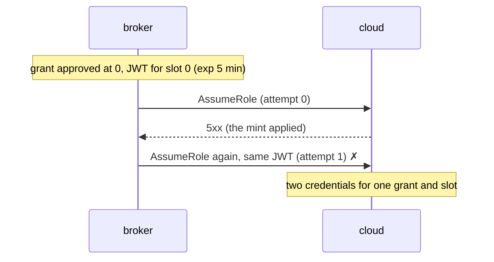

**`waitForAnswer` breaks L1** (design: the attempt is dropped once the JWT has expired, and slot 1 mints).

```mermaid
sequenceDiagram
  participant B as broker
  participant C as cloud
  Note over B: grant 30 min from 0; JWT slot 0, exp 5 min
  B->>C: AssumeRole (attempt 0)
  C--xB: credentials (answer lost)
  Note over B: 10 min: no copy can land, but the broker still waits for an answer ✗
```

**`passkeyNotBound` breaks P3** (design: refused, "passkey").

```mermaid
sequenceDiagram
  participant A as sbxA
  participant W as yard-ctl
  participant U as user
  A->>W: request iam (req 1); request iam (req 2)
  W->>U: card 1 (h1, escalation); card 2 (h2, escalation)
  U->>W: challenge for card 1
  W-->>U: challenge (h1, at 0)
  U->>W: approve card 2 with the assertion over h1 ✗ accepted
  Note over W: grant h2 without a passkey bound to h2, then minted
```

**`passkeyNotFresh` breaks P3** (design: refused, "passkey").

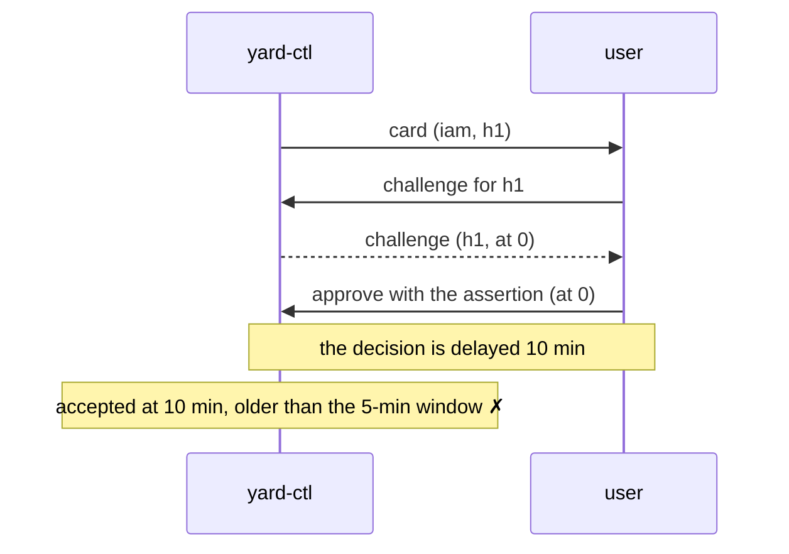

**`rawForward` breaks strict P6** (Azure; design: the VM gets a surrogate).

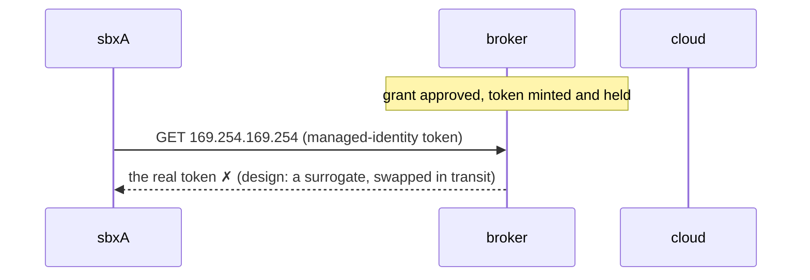

**`forwardJwt` breaks P6** (design: the JWT stays in the broker).

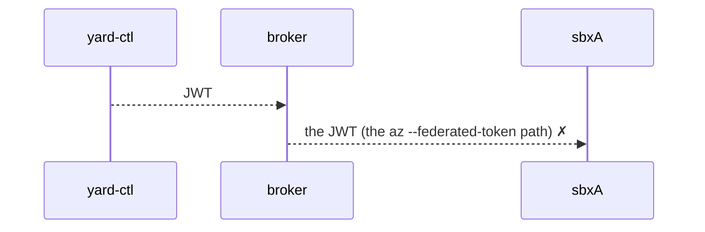

**`ttlNotClamped` breaks P1b** (design: the grant ends at 20 min, so no JWT is signed after 5 min).

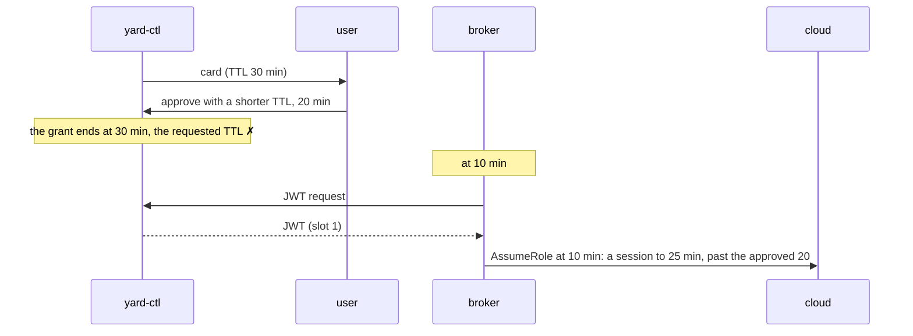

**`expiryAtRequest` breaks P1b** (design: the JWT expires at 5 min = grant end − 15 min, and the late copy is refused).

```mermaid
sequenceDiagram
  participant W as yard-ctl
  participant B as broker
  participant C as cloud
  Note over W: grant 0–20 min
  B->>W: JWT request at 5 min; W checks "live at request"
  W-->>B: JWT, exp 10 min (not clamped to the grant end) ✗
  B->>C: AssumeRole, delivered at 10 min
  C-->>B: a session from 10 to 25 min, past the grant's end
```

**`expiryAtClick` breaks P5a** (design: refused, "expired", dated at arrival).

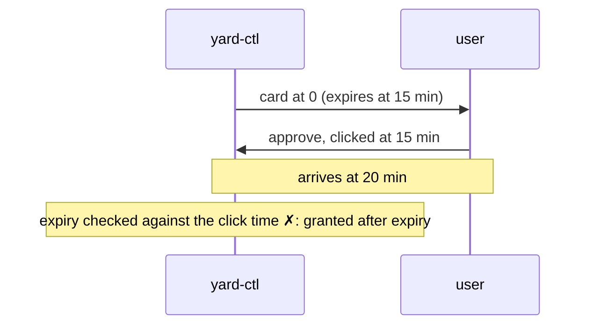

**`draftApproves` breaks P2** (design: the card waits for the user).

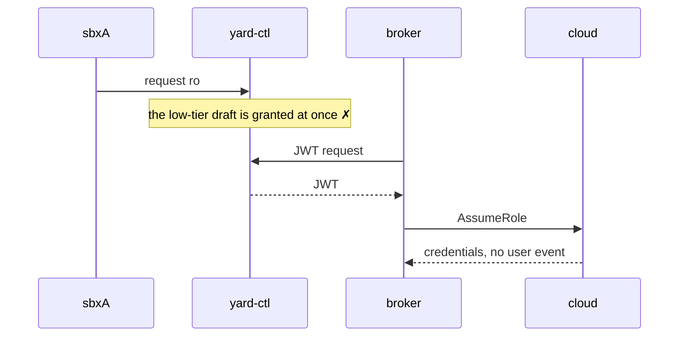

**`replayExtends` breaks P4a** (design: refused, "status"; the grant keeps its start).

```mermaid
sequenceDiagram
  participant W as yard-ctl
  participant U as user
  U->>W: approve h1 at 0; W: grant 0–20 min
  Note over U,W: 10 min later the same decision is delivered again
  Note over W: the grant restarts, 10–30 min ✗
```

**`trustClaimed` breaks P7** (design: the subject is the tap, sbxB has no grant, nothing is served).

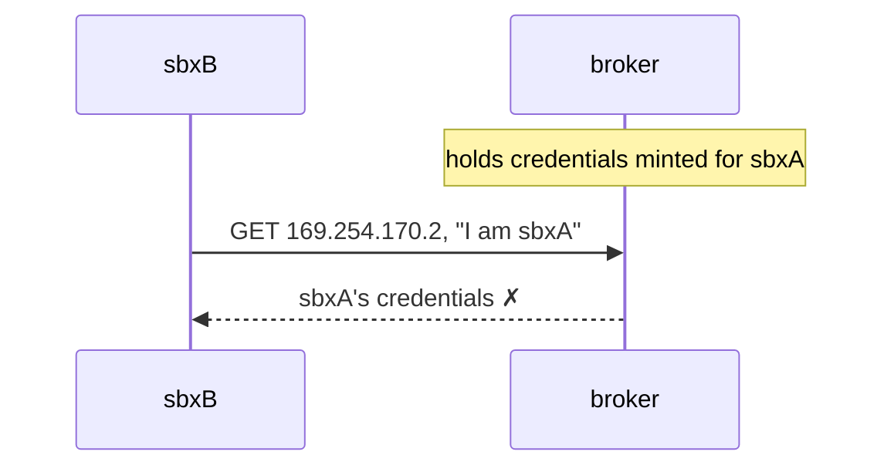

**`asWrittenEnd` (WARDEN.md before 2026-10-07) breaks P1b** (design, D1: no JWT after grant end − 15 min).

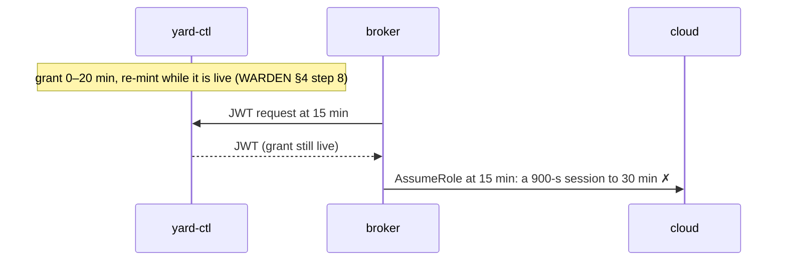

**`asWrittenRevoke` (WARDEN.md before 2026-10-07) breaks P5b** (design, D2: cutoff = revoke + 5 min).

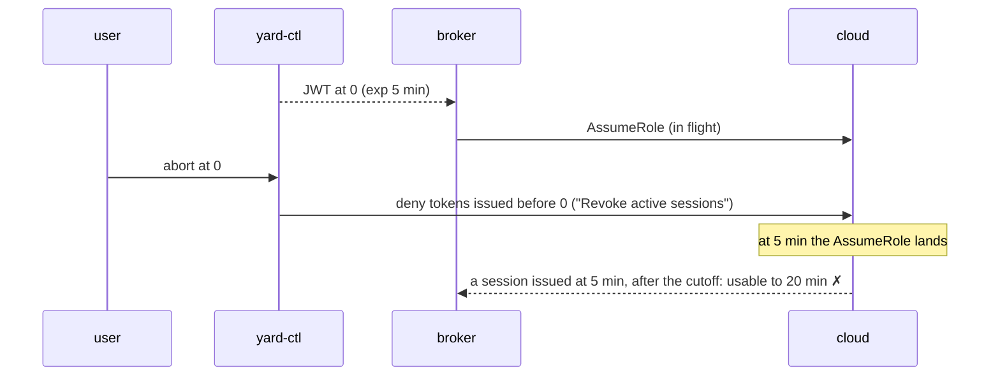

**`sessionTemplateButton` (WARDEN.md before 2026-10-07) breaks P1a, not P2** (design, D3: no button).

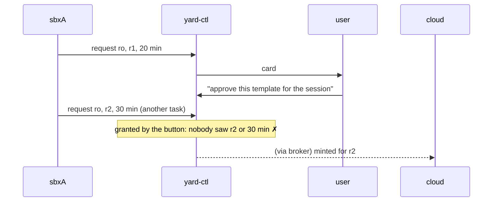


**`staleEpochAccepted` breaks P8** (design: the exchange is refused; `staleEpochAcceptedDesignTest`).

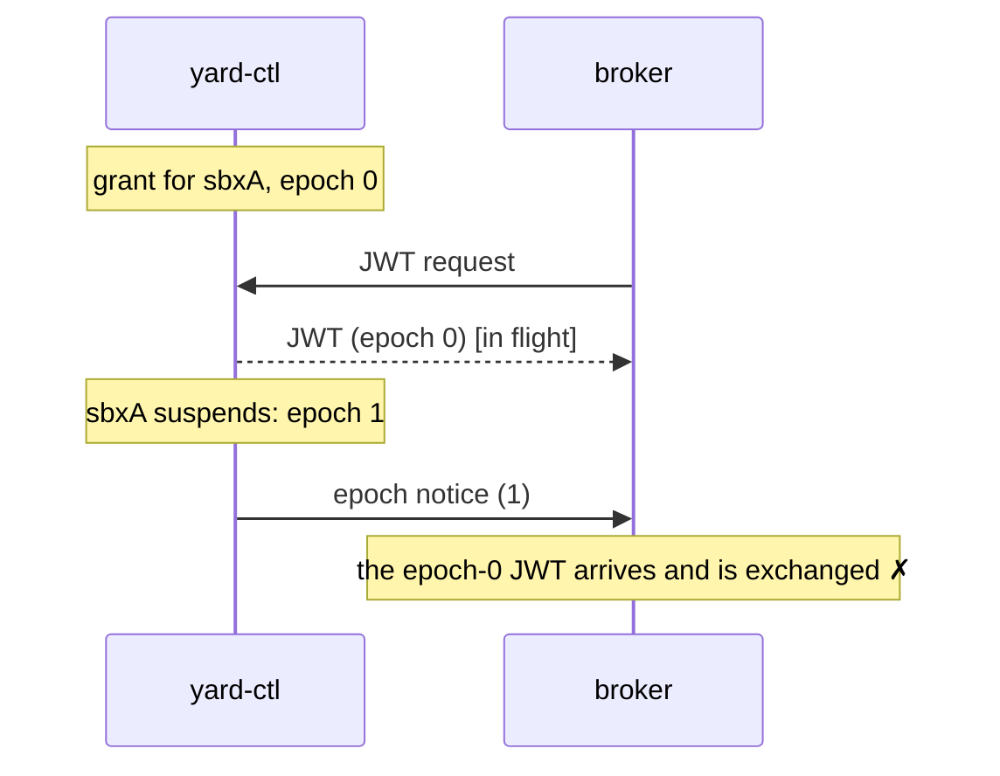

**`noReconciler` breaks L2** (design: `reconcileTest` records the orphan).

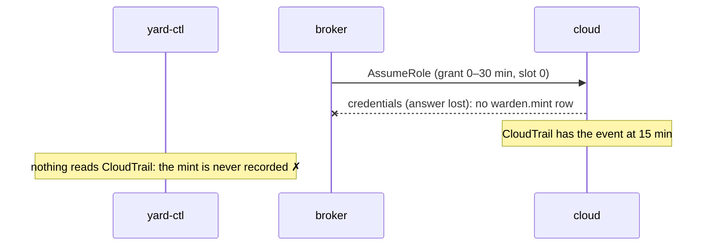

**`supersedeKeepsGrant` breaks P5c** (design: `supersedeRevokesTest`, the old grant is revoked).

```mermaid
sequenceDiagram
  participant A as sbxA
  participant W as yard-ctl
  participant U as user
  A->>W: request ro, r1; U->>W: approve; W: grant v1
  A->>W: re-request ro, r2 (same task)
  W->>U: card v2
  U->>W: approve v2; W: grant v2
  Note over W: grant v1 is still live ✗ (two live grants for one task)
```

**`resumeWithoutBrokerAck` breaks P8** (design: the session stays "resuming" until the broker acknowledges; `resumeAckTest`).

```mermaid
sequenceDiagram
  participant W as yard-ctl
  participant B as broker
  Note over B: holds sbxA's credential of epoch 0
  Note over W: sbxA suspends: epoch 1
  W->>B: epoch notice (1)  [lost]
  Note over W: resume marks sbxA active without the broker's acknowledgement ✗
  Note over B: still holds and serves the epoch-0 credential
```

**`orphanOnlyRecorded` breaks L2** (design: `reconcileTest` records the orphan and the cloud applies its deny).

```mermaid
sequenceDiagram
  participant W as yard-ctl
  participant C as cloud
  Note over C: a mint whose answer was lost (no warden.mint row)
  Note over W: at 15 min the reconciler finds it in CloudTrail
  Note over W: records it, sends no revoke ✗
```

## Findings, and the decisions of 2026-10-07

The first version of this model (commit d9bf009) found, in WARDEN.md as it
stood on 2026-10-06:

1. **Credentials outlived the approved TTL by up to 15 minutes**
   (`asWrittenEnd`): re-minting "while the grant is live", with 900-s
   sessions (AWS's minimum), let the last session run past the TTL.
2. **"Revoke active sessions" missed a mint already in flight**
   (`asWrittenRevoke`): the cutoff was the revoke time, so a JWT signed just
   before the abort minted a session after it. The revoke also hit the whole
   `yard-task` role.
3. **The session-template button contradicted "no auto-approval"**
   (`sessionTemplateButton`): it minted later cards with parameters nobody
   saw.
4. AWS mode hands the VM its credentials (decision 5 of 2026-10-06), which
   the strict P6 rejects. This one stands: it is the approved trade-off, and
   the model keeps both forms of P6.

The user accepted all twelve recommendations on 2026-10-07, and then three
more on the model's remaining questions (13–15 below); WARDEN.md has them in
"Decisions 2026-10-07 (from the Quint model)". In the model:

| # | Decision | In the model |
|---|---|---|
| 1 | The approved TTL bounds credential expiry: no JWT after grant end − 15 min, each JWT's exp clamped | `endRule: FenceAtMint`, `mintable`, `jwtExp`; P1b; mutants `asWrittenEnd`, `expiryAtRequest`, `ttlNotClamped` |
| 2 | Revoke cutoff = revoke + 5 min, scoped to the task by session tag | `cutoff: CutoffAfterSettle`; the deny is per grant; P5b; mutant `asWrittenRevoke` |
| 3 | No session-template button | `sessionTemplate: false`; mutant `sessionTemplateButton` |
| 4 | Passkey per card, single-use challenge, fresh 5 min, signs the final hash | `passkeyOk` (issued, unused, bound, fresh); P3; `passkeyBindsShortTtlTest`, `passkeyShortTtlTest`; mutants `passkeyNotBound`, `passkeyNotFresh` |
| 5 | The hash covers policy, scope, TTL, account, region, RoleSessionName; a shorter TTL re-hashes | `finalContent`; the decision carries the final hash; P1a; mutant `approvalNotHashBound` |
| 6 | Never resend a JWT; SDK retries off; wait for the JWT to expire, then the next slot; reconcile afterwards | `retry: NextSlot`; L1; `lostAnswerRemintTest`; mutants `blindRetry`, `waitForAnswer` |
| 7 | Re-mints keyed by (grant, 10-min slot); an IP change is a new slot under a per-grant cap | `issued` keyed (grant, slot, IP generation), cap 3; P4b, P4c; `ipChangeRemintTest` |
| 8 | The broker calls AssumeRole; the warden authorises; `yard-psha` session tag | the broker's `act_exchange`; `Cred.h` is the tag; P1a checks it equals the hash of the minted policy |
| 9 | Card expiry judged when the approval reaches the warden | `expiryAt: AtArrival`; P5a; mutant `expiryAtClick` |
| 10 | Withdraw revokes; approving a newer request supersedes and revokes the old grant | `revokeOnSupersede`; P5c; `withdrawRevokesTest`, `supersedeRevokesTest`; mutant `supersedeKeepsGrant` |
| 11 | The TTL runs from the approval | `newGrant` starts at acceptance |
| 12 | A CloudTrail reconciler for lost-answer mints | `listen_reconcile`; L2; `reconcileTest`; mutant `noReconciler` |
| SR0 | The broker refuses JWTs of a stale session epoch | `epochCheck`; P8; `staleEpochAcceptedDesignTest`; mutant `staleEpochAccepted` |
| 13 | Resume completes only on the broker's acknowledgement; the broker pulls epochs on start and reconnect | `brokerAck`, `act_resume`/`act_epoch_ack`, `act_need_pull`/`act_epoch_state`; P8; `resumeAckTest`, `brokerRestartPullTest`, `resumeWithoutBrokerAckDesignTest`; mutant `resumeWithoutBrokerAck` |
| 14 | Cap 3 and lag 15 min as stated assumptions (lag to measure) | `MAX_MINTS_PER_GRANT`, `CT_LAG` |
| 15 | A reconciled orphan is revoked, tag-scoped by its own mint | `orphanRevoke`, `OrphanDeny`, `usable`; L2; `reconcileTest`; mutant `orphanOnlyRecorded` |

**What no longer holds, or holds only weakly.**
- P8 covers what the broker exchanges and holds, not an `AssumeRole` already
  in flight when a suspend moves the epoch: that cannot be recalled. Its
  answer is refused on arrival, and the mint it made is an orphan that the
  reconciler records and revokes.
- The gap of the previous round (a lost epoch notice letting the broker
  serve an old-epoch credential for up to 15 minutes) is closed by
  decision 13: the resume waits for the acknowledgement, and P8 now checks
  the session's current epoch, not only the broker's view of it.
- The orphan revoke (decision 15) protects a property only when the measured
  CloudTrail lag is shorter than the 15-minute session: with the assumed
  lag of 15 minutes, an orphan has already expired when the reconciler finds
  it. `orphanOnlyRecorded` therefore breaks the liveness check L2 (an
  orphan's revoke is never sent), not a safety property.
- The orphan's deny names a per-mint session tag (`yard-mint` = grant, slot,
  IP generation). That tag is this model's way to scope the revoke to one
  mint (decision 2 scopes by task); it adds one session tag per JWT.

## Remaining questions for the user

None from the model. The two assumptions to measure or confirm in W1: the
CloudTrail delivery lag on the sandbox account (taken as 15 minutes), and
that a per-mint session tag in the JWT reaches the session as
`aws:PrincipalTag/yard-mint`.

## Not modelled

- The `aws:SourceIp` pin itself and the advertised
  `Expiration = min(real, now + 5 min)`; the IP poll's period.
- Azure specifics: role-assignment creation and deletion as ambiguous calls,
  the 10-minute ARM cache after deletion, RG teardown, the surrogate swap's
  MITM; Azure is the same mint abstraction with a surrogate in the VM.
- The yard-ctl → signer hop (sequence numbers), the audit chain and OTel, the
  training facts (TRAINING-DATA.md: approve, deny and shorter TTL are
  labelled facts; the model's `userApproved` ghost is the same event).
- Account and RoleSessionName as separate fields: they are folded into the
  card's `sbx` and `region`, which the hash covers.
- Rate limits and approval fatigue, risk tiers beyond "escalation or not",
  the content of the checks (one `blocked` predicate), templates, Terraform
  plan cross-checks.
- Tag ABAC inside the account, SCPs, RCPs, budgets, teardown and the nightly
  nuke; one broker and one node; the approver's identity (WhoIs) and a stolen
  device (the user is one trusted process).
- Liveness beyond L1 and L2: `quint run` checks state invariants on finite
  runs. The witnesses and the scripted runs show the recovery paths.
